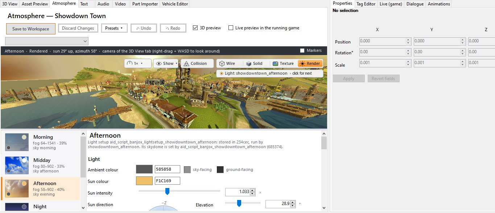

<p align="center">
  
</p>

<h3 align="center">Open Showdown Town. Move L.O.G.'s palace. Paint the sky purple. Press F5 and drive through it.</h3>

<p align="center">
  <b>NB Studio</b> is a world editor and modding toolkit for <i>Banjo-Kazooie: Nuts &amp; Bolts</i> (Xbox 360).<br>
  It opens every world and Act of the game in 3D, lit the way the game lights them, and lets you change almost
  everything you can see (and hear), then test it in Xenia in seconds and share it as a small mod.
</p>

<p align="center">
  
  
  
  
</p>

<p align="center">
  <a href="https://github.com/weighta/NB-Studio/releases/latest"></a>
  <a href="src"></a>
  <a href="https://github.com/weighta/NB-Multiplayer"></a>
</p>

---

## Contents

- [A tour of the editor](#a-tour-of-the-editor)
  - [Every world, lit like the game](#every-world-lit-like-the-game)
  - [Atmosphere: sky, light and fog for every Act](#atmosphere-sky-light-and-fog-for-every-act)
  - [Move, copy and paste anything](#move-copy-and-paste-anything)
  - [The collision editor](#the-collision-editor)
  - [Cameras and cut-scene paths](#cameras-and-cut-scene-paths)
  - [Music regions and your own music](#music-regions-and-your-own-music)
  - [Vehicle Editor](#vehicle-editor)
  - [Animations and FBX export](#animations-and-fbx-export)
  - [Source maps (.vmf) as playable worlds](#source-maps-vmf-as-playable-worlds)
  - [F5: Test in Xenia at 60 FPS](#f5-test-in-xenia-at-60-fps)
  - [The Live (game) tab](#the-live-game-tab)
  - [Textures, text, audio and video](#textures-text-audio-and-video)
  - [Xbox 360 photo viewer](#xbox-360-photo-viewer)
  - [Mods, patches and NB Multiplayer](#mods-patches-and-nb-multiplayer)
- [Everything at a glance](#everything-at-a-glance)
- [Installation](#installation)
- [Tutorial: your first mod](#tutorial-your-first-mod)
- [How the tool works](#how-the-tool-works)
- [Research: the game's file formats](#research-the-games-file-formats)
- [Building from source](#building-from-source)
- [Related: NB Multiplayer](#related-nb-multiplayer)
- [Credits and legal](#credits-and-legal)

---

## A tour of the editor

### Every world, lit like the game

<p align="center">
  
</p>

Showdown Town, Nutty Acres, LOGBOX 720, Banjoland, Terrarium of Terror, Spiral Mountain, World of Sports, Banjo's
House and the test track: every world and every Act opens in the 3D view with its terrain, scenery, water, grass, sky
dome and everything the game places with markers. L.O.G.'s palace, the Jiggy bank, Jig-o-Vends, cranes, doors, crates,
notes, Jinjo houses, act vehicles and the characters (in their idle pose) are drawn with their real models.

The **Rendered** view runs a translated copy of each material's own Xbox 360 pixel shader, so metal, glass,
reflections, texture tiling and tints come out as in the game. It lights the level with the light setup the level
scripts run: sun, fill light, sky-and-ground ambient, shadows, two fog bands and the game's field of view. Wireframe,
Solid and Textured are one click away, and the **Show** menu turns terrain, scenery, objects, grass, water, sky,
markers, paths, cameras, music regions and collision on and off.

<p align="center">
  
</p>
<p align="center"><i>Nutty Acres, Act 1, in the full editor: worlds and Acts on the left, the 3D view in the middle, Properties,
Tag Editor, Live (game), Dialogue and Animations on the right. The pink dots are the Act's notes and pickups.</i></p>

Fly with **W A S D Q E** (Shift = fast, with a speed menu), look with the right mouse button, and each world remembers
where you left the camera.

### Atmosphere: sky, light and fog for every Act

<p align="center">
  
</p>
<p align="center"><i>One street, four light setups: Showdown Town's morning, midday, afternoon and night, straight from the game files.</i></p>

The **Atmosphere** tab edits the sky, light and fog of every time of day in Showdown Town and of every Act in the other
worlds: ambient and sun colour (with a live colour picker), sun intensity and direction, fog start, end, strength and
colour, fill light, and the sky dome and its textures. A **3D preview** shows each change at once, shadows following the
sun as you drag it. Presets (including a winter one) give you a starting point, and *World > Weather* adds falling snow.

Tick **Live preview in the running game** and the colours, intensity and fog change in the game running in Xenia while you
drag the sliders. Shared light setups (used by several Acts, or copied into several files) are named before saving, and
every copy is written.

<p align="center">
  
</p>

### Move, copy and paste anything

<p align="center">
  
</p>
<p align="center"><i>Mumbo's Motors selected in the Rendered view: one box for the selection, the gizmo at its centre, exact values in Properties.</i></p>

- **Blender-style keys:** **G** moves, **R** rotates, **S** or **T** scales, then **X / Y / Z** locks an axis and a typed
  number sets an exact amount. Or drag the gizmo, or type values in *Properties*.
- **Select many:** Shift/Ctrl-click, **B** or Ctrl+drag for a rectangle, Ctrl+A. **H** hides, **U** shows everything again.
- **Ctrl+C / Ctrl+V** copies scenery, and the copy is self-contained: its models, textures, lightmaps and collision are
  packed, so you can paste it into **another world or another workspace**. A paste lands where the mouse points and is
  one undo step. *Copy With Level Collision* brings the level collision inside the object's box along; *Copy Mesh Only*
  (Ctrl+Shift+C) leaves it behind.
- **Ctrl+X** lifts any object (Thomas, a warp pad, a camera, a crate) and **Ctrl+V** puts it down under the mouse.
- **Undo everything** with Ctrl+Z / Ctrl+Y: moves, file writes, imports, atmosphere, collision and texture saves.
  **Ctrl+S** saves everything pending, and nothing is lost by switching worlds: NB Studio asks first.
- Duplicate, delete, import OBJ/FBX models in place of scenery, edit AI race routes and path links, move water, set the
  player start, and edit characters' **dialogue** lines in every language.

### The collision editor

<p align="center">
  
</p>

**Edit Collision** decodes the world's Havok collision (606,538 triangles in Showdown Town, in a fraction of a second)
and makes it clickable: pick a whole piece, a face or single triangles, or drag a rectangle. Move, rotate, scale, delete,
copy and duplicate collision; add boxes, ramps and planes; build collision from an object's render mesh. *World > Save*
rebuilds the collision with a search tree at the game's own resolution and keeps each triangle's surface material.
Checked in the game: an added box blocks the vehicle, a deleted wall lets it drive through, and moving scenery moves its
collision with it.

### Cameras and cut-scene paths

<p align="center">
  
</p>
<p align="center"><i>The fly-around of L.O.G.'s palace intro: 27 editable keys along a 25.7-second camera path. The cyan cameras are fixed views.</i></p>

Fixed cameras are drawn as cyan cameras with their view cone: the **WARP TO** view of every warp pad, bolt-head
close-ups, the Jiggy Bank and info points. Right-click to **Look Through Its Camera**, set a camera from the 3D view,
or select a warp pad's camera; moving a warp pad takes its camera along. All 125 cut-scene cameras of Showdown Town can
be shown as paths. Open one and its keys (one per second) are editable objects: move or turn a key and the path bends
around it and fades into the neighbouring keys.

### Music regions and your own music

<p align="center">
  
</p>

Showdown Town's music is one piece made of six synchronized district tracks (Market, Seaside, Docks, Park, Posh and
L.O.G.), and **32 music regions** decide which one plays where. *Show > Music* draws them as coloured rings with speaker
labels. Select a region to move or resize it, give it any of the game's **133 tracks** per time of day, preview it with
▶, or **Replace…** the track with your own song (WAV, MP3, OGG, FLAC or M4A; mono, 22 kHz, loop and fit-to-length
options, or "All six districts" at once). *Audio > Music* lists every track with where it plays, with Play, Replace…
and Export WAV. Replacements were checked in Xenia in every music bank.

### Vehicle Editor

<p align="center">
  
</p>
<p align="center">
  
</p>
<p align="center"><i>Mr. Fit's Burnin' Rubber racer, the L.O.G. Pizza Wagon, a 249-part vehicle left in the game's files, and the Game Vehicles picker.</i></p>

Build vehicles the way Mumbo's garage does, without its limits:

- **Game Vehicles** lists all 275 vehicles in the game files by World › Act › challenge (the racers, Mr. Fit's and
  Blubber's vehicles, shop blueprints, leftover demo and test vehicles), with search. One click opens one.
- **Drag and drop parts** from a library laid out like the Parts Store: the preview snaps to the face under the mouse,
  green when it attaches. Rotate to any of the 24 orientations, paint with the 13 garage colours or any RGB colour (drawn
  with the game's paint formula), set wheel and propeller settings and A / B / X action buttons. No part limit.
- **Checks** warns about floating parts, overlaps, missing AI seats and parts below the floor; AI drivers' vehicles get
  a note and a **Use AI parts** button.
- **Open and save** Xbox 360 vehicle saves (packages or extracted content files) and the game's own vehicles; drop a
  360 vehicle onto a game vehicle to replace it. **My Vehicle Saves** is shared across workspaces and with NB
  Multiplayer, and vehicles saved during an F5 test show up there.

### Animations and FBX export

<p align="center">
  
</p>

Select a character and the **Animations** tab lists every action it has and the animation each one plays (Thomas has
62). Play, pause, loop, change the speed from 0.25× to 2× or scrub frame by frame, right in the world. **Export FBX…**
writes the model, skeleton, skin, the chosen animation and its textures (tested in Blender). Any model can also be
exported to OBJ or FBX from the right-click menu.

### Source maps (.vmf) as playable worlds

<p align="center">
  
</p>

*Tools > Import Source Map (.vmf)* turns a Hammer map into playable Showdown Town geometry: brushes and displacements
become textured models with collision, the map's textures come from your Source game's folders and VPKs, and its lights
(`light`, `light_spot`, `light_environment`) are baked into lightmaps with shadows. Tool textures are never drawn, the
3D skybox can be ported as full-size terrain, glass and cut-outs work, and the outer nodraw hull is dropped. Before
anything is written, the dialog shows a memory budget against what a real Xbox 360 runs. Props can come from a folder
of OBJ/FBX files.

### F5: Test in Xenia at 60 FPS

Press **F5** and NB's Xenia boots straight into the world or Act you have open, with no title screen, menus or intro:
Showdown Town and Nutty Acres Act 1 are playable in about 30 seconds. **Shift+F5** starts you at the 3D view's camera,
**Ctrl+F5** at the title screen.

- Tests run at **60 FPS** by default (game speed unchanged), applied by Xenia in memory and never written into your
  workspace or mods. Turn it off in *Mods > Test in Xenia at 60 FPS*. (Based on Margen67's 60 FPS patch.)
- The test game skips Mumbo's tutorials and first-visit remarks, keeps its own save per workspace, can start from a full
  all-unlocked save, and never touches your real saves.
- Unsaved edits? F5 offers *Save all and test / Test last saved / Cancel*, and the status bar says what was tested.

<p align="center">
  
  
</p>
<p align="center"><i>Left: the Mods menu, with the researched executable mods and the 60 FPS test option. Right: the Live (game) tab.</i></p>

### The Live (game) tab

Attach to the game running in Xenia (it finds the F5 game by itself) and play with it while it runs: **teleport**
Banjo or his vehicle to typed coordinates, to the 3D view's camera or to per-world **bookmarks**, **nudge** along an
axis, change **gravity** (Moon, Zero-G, Heavy or anything in between; it sticks across level loads), move the 3D view to
the player, or fly the game's photo camera to where the 3D view is looking from (it passes through walls).

### Textures, text, audio and video

<p align="center">
  
</p>

- **Texture library:** every texture of a model or a whole world with thumbnails: export PNG, edit externally and apply,
  replace one, or replace from a folder in one go (*Only this model* leaves other models alone). All 14,049 textures
  decode (DXT1/3/5, DXN, CTX1, ARGB, cube and volume maps).
- **Text** in all languages, the **Audio** tab's wave banks (play, export and replace sound effects; vgmstream is
  included), and **video** replacement.
- The **Part Importer** builds new garage parts: model, physics, stats, attach points and garage tier dialogs.

### Xbox 360 photo viewer

*Tools > Xbox 360 Photo Viewer*: drop the photo packages your console saves with *Take Photo* (one or many) and the
photo pops up. Save it as PNG, JPEG or BMP, copy it, drag it out, or auto-extract every dropped package. *Import Image
into Package* (Ctrl+I) puts your own picture into a photo package (1280×720 JPEG and thumbnail, package hashes
recomputed), and the game's Photo Album shows it. Dropping packages on `NBModStudio.exe` opens just the viewer.

### Mods, patches and NB Multiplayer

<p align="center">
  
</p>
<p align="center"><i>Snowy Showdown Town, the first official map mod (bundled with NB Multiplayer), made with these tools: snow textures, holly and bunting, camera-following snowfall and winter light, fog and skies.</i></p>

- **Create Distributable Patch (.nbpatch):** a small differential patch with only your changes, plus its name,
  version, category (maps, vehicle parts, gameplay, visuals, audio, tweaks, co-op), tags and description. It contains
  no game data. Others apply it to their own copy with backup and rollback.
- **Create Patch from a Modified Game Folder:** a folder modded by hand becomes a mod. NB Studio compares it with the
  retail files, lists what changed per asset, recognises known executable tweaks and fills in the details.
- **Executable mods** from the *Mods* menu: Change Vehicle in Showdown Town, destructible town vehicles, all parts
  unlocked, bigger world and garage, longer draw distance, part limits, co-op hooks and more, as Xenia patches or
  baked into `default.xex`.
- **reNut custom parts** (*Build > reNut Parts*, new; arrives in the next release): new vehicle parts for
  [reNut](https://github.com/masterspike52/reNut), the native PC version. Part files in the workspace's
  `renut\parts` folder, your own OBJ models built from `renut\models.json` into bundles of the mod's own (with
  collision, footprints, textures and wheels that spin), a checker that reads the parts the way reNut does, and
  *Create Distributable Patch* packs them into the `.nbpatch`.
- **Combining mods:** mods that touch the same file are merged asset by asset, conflicts are named down to the asset,
  and *world edits* replay on top of other mods.
- **[NB Multiplayer](https://github.com/weighta/NB-Multiplayer)** puts it all in a mod library: combine your mods into
  editions and play them online with friends, including Showdown Town co-op and Character Select. It also installs and
  updates NB Studio and lists your projects.

Everything is non-destructive: NB Studio works on a **workspace** (a copy of your game), never on your original files,
and keeps a history of every saved file.

## Everything at a glance

| Area | What you can do |
|---|---|
| **Worlds** | Every world and Act, with terrain, scenery, water, grass, sky domes, markers, AI paths, collision and the objects placed at markers drawn with their real models. Wireframe, Solid, Textured and Rendered (the game's own shaders and lighting). |
| **Editing** | G / R / S (T) with axis locks and typed values, gizmo, multi-select, hide/unhide, duplicate, delete, lift and place (Ctrl+X / Ctrl+V), undo/redo of everything, Ctrl+S saves all. |
| **Copy and paste** | Self-contained copies between worlds and workspaces, with their models, textures, lightmaps and collision. |
| **Collision** | View all collision; edit it triangle by triangle; add boxes, ramps and planes; build from render meshes; import OBJ/FBX collision. |
| **Markers and paths** | Actor spawns, pickups, volumes, script triggers, player starts, AI race routes and AI vehicles on your own routes. |
| **Cameras** | Warp-pad, bolt-head, Jiggy Bank and info-point cameras; cut-scene camera paths with editable keys. |
| **Atmosphere** | Sky, light, fog and sun direction per time of day and per Act, live 3D preview, live preview in the running game, falling snow. |
| **Music** | Showdown Town's 32 music regions, the 133 tracks, replacing music with your own songs. |
| **Vehicles** | Vehicle Editor: game vehicles, Xbox 360 vehicle saves, drag-and-drop parts, paint, settings, checks, My Vehicle Saves. Part Importer for new parts. |
| **Characters** | Animations tab (play, scrub, FBX export with skeleton and skin), dialogue lines in every language. |
| **Assets** | Models (OBJ/FBX export and import), all 14,049 textures, text, wave banks, videos, Tag Editor for raw values. |
| **Source maps** | Hammer `.vmf` import with baked lightmaps, collision, skybox terrain and memory budget. |
| **Testing** | F5 straight into the open world or Act at 60 FPS, Shift+F5 from the camera; the Live (game) tab. |
| **reNut parts** | Custom vehicle parts for reNut: part files, OBJ models with collision and footprints, spinning wheels, checks, packed into `.nbpatch` mods. |
| **Sharing** | `.nbpatch` mods, mods from modded folders, executable mods, mod combining, NB Multiplayer's mod library. |
| **Extras** | Xbox 360 Photo Viewer, a guided tour on the first start (*Help > Take the Tour*), `cli/NB.Cli.exe` with over 100 commands. |

## Installation

1. **Download** the latest `NB-Studio-x.y.z.zip` from the [Releases](https://github.com/weighta/NB-Studio/releases) page and unzip it anywhere.
   (Or let [NB Multiplayer](https://github.com/weighta/NB-Multiplayer) do it: *Projects > Get NB Studio* installs NB
   Studio, keeps it up to date and lists your projects.)
2. You need **your own copy of the game**, extracted to a folder: the folder that contains `default.xex` and the
   `Bundle` folder (for example extracted from your disc image with *extract-xiso*). NB Studio never changes this folder.
3. Run **`NBModStudio.exe`**. Requirements: Windows 10/11 64-bit, a GPU with OpenGL 3.3. The release is
   self-contained: no .NET install needed.
4. For testing, **F5** uses NB's own Xenia build, which comes with [NB Multiplayer](https://github.com/weighta/NB-Multiplayer)
   (its virtual gamepad is what skips the menus). Without it, NB Studio asks for a
   [Xenia Canary](https://github.com/xenia-canary/xenia-canary) and starts the game at the title screen.

## Tutorial: your first mod

**1. Create a workspace.** On the start page choose *New Workspace from Game Directory...*, pick your game folder, then
an empty folder for the workspace. NB Studio copies the game there (a few minutes, about 7 GB) and indexes its 69,000
assets. First time? NB Studio offers a 2-minute tour of the window.

**2. Open a world.** The *Worlds* list shows every world and Act. Double-click **Showdown Town**. The 3D view opens:
right-drag to look around, WASD/QE to fly (Shift = fast), mouse wheel to dolly, middle-drag to pan, F to focus the selection.
The buttons in the top-right corner switch between Wireframe, Solid, Textured and Rendered (game lighting).

**3. Move something.** Click a piece of scenery (for example a café table near Mumbo's Motors). Press **G** and move
the mouse, then click to drop it; press **X**, **Y** or **Z** while moving to slide along one axis only, or type a number
(G, Z, 3.5, Enter moves it 3.5 units up). **R** rotates and **S** (or **T**) scales the same way. You can also drag the
gizmo's arrows (Move 1 / Rotate 2 / Scale 3), or type exact numbers in *Properties* and press *Apply*. Ctrl+Z undoes.

**4. Change a texture.** Right-click the object and choose *Textures... (view / export / replace)*. The texture library shows every texture the
model uses (*World > Texture Library* shows every texture of the world). Select one, *Export PNG*, paint over it, then *Replace...* with your image (tick *Only this model* to
leave other models that share the texture alone).

**5. Import a model.** Right-click scenery, *Import Model (replace geometry with OBJ/FBX)...*, pick an OBJ or FBX. It
replaces the object's model, importing the file's materials and textures. For collision use *Import Collision
(OBJ/FBX)...*.

**6. Save and test.** **Ctrl+S** (*Save All*) writes your changes into the workspace. **F5** (*Test in Xenia*) starts
the game right in the world you have open.

**7. Share it.** *Build > Create Distributable Patch (.nbpatch)...* asks what the mod is (name, version, category,
tags, whether multiplayer players need it, description; the category starts as a guess from the files you changed) and
writes a `.nbpatch`. Other players apply it with *Build > Apply Patch to a Game Directory...* (it checks their files
first and keeps a backup; *Roll Back Patches* undoes it), or add it to the mod library of
[NB Multiplayer](https://github.com/weighta/NB-Multiplayer), combine it with other mods and tweaks, and play it online.

## How the tool works

```
NBModTool.sln
├── src/NB.Core         format library: xcompress, CAFF, bundles, textures, models, markers, scripts, collision,
│                       animations, text, audio, executable, workspace, patches, room server (multiplayer)
├── src/NB.Studio       the desktop editor (WinForms + OpenGL 3.3)
├── src/NB.Cli          command-line tools (over 100 commands: extraction, round-trip tests, batch edits)
└── src/NB.Multiplayer  the NB Multiplayer app (WPF), see the NB Multiplayer repository
docs/FORMATS.md         the file-format reference (summary below)
docs/STATUS.md          what is verified, what works, what is experimental
docs/research/          deep dives: garage, destruction, camera, debug menus, draw distance, animation codec...
research-tools/probe/   the Python scripts used to work the formats out
```

**Reading.** The game's 151 resident bundles (`Bundle/4f`, most xcompress/LZX-compressed) are decompressed in memory
into CAFF containers; streamed data (`Bundle/50`) is read from archives on demand. Every asset (69,000 of them) is
indexed by id, name, type and bundle; ids are a CRC-32 of the name, so a name always tells you where to look.

**Editing.** Every edit goes through the same path: parse the asset, change it, rebuild the CAFF (parts re-aligned,
relocation tables regenerated, checksum recomputed) and write the bundle back **uncompressed**. The game loads
uncompressed bundles fine, so no recompression is needed. Each save is recorded in the workspace's change log and history
(undo per file, revert to original).

**Sharing.** A `.nbpatch` holds binary deltas (COPY/ADD operations) of each changed file against the expanded
original, plus the SHA-256 of the expected source and result. Applying verifies both, so a patch only ever applies to the
exact game files it was made for, and never distributes game data. Its `patch.json` (format 2) also names the mod: `Id`,
`Version`, `Category` (`map`, `parts`, `gameplay`, `visual`, `audio`, `tweak`, `coop`), `Tags`, `Multiplayer`
(`world`, `cosmetic`, `coop`), `Requires` and `Conflicts`.

**Stacking.** `src/NB.Core/Project/ModStack.cs` applies several mods to one game copy (NB Multiplayer editions). Files
that several mods change are merged asset by asset (`ModMerge.cs`, three-way against the original: every changed asset is
taken from the mod that changed it; CAFF symbols and stream-archive entries alike); two mods changing the same asset
differently is a conflict, reported by name. Then every mod's **world edits** (`patch.json` format 3 `Ops`, see
`WorldOps.cs`: objparams-copy/set, asset-copy, ai-route, script-insert located by content) are replayed in recipe
order, and the executable mods are merged into one `default.xex` (a word two mods change must get the same value).
`NB.Cli stack-check / stack-apply / stack-explain` show what combines and why not. Game copies made of hard links are
never written through: a changed file always becomes a file of its own.

**Modded folders.** `src/NB.Core/Project/GameDiff.cs` compares a folder with `Data/retail_fingerprints.json` (path, size,
SHA-256 of the 1,981 retail files), finds a clean reference among candidate folders (it must have the retail version of
every changed file), lists changed/added/removed assets per bundle, and diffs the executable image word by word
(complete known executable mods are recognised; other words become one executable mod of the new patch).
`PatchPackage.BuildFromFolders` then writes an ordinary `.nbpatch`.

**Testing.** Xenia runs the workspace's game directory; executable mods are written as Xenia patch files (or baked into
`default.xex` for consoles that run unsigned code). The *Live (game)* tab attaches to a running Xenia and reads/writes
guest memory for teleporting, gravity and photo-mode camera control.

## Research: the game's file formats

Everything here was established against the unmodified game and is documented in full in
**[docs/FORMATS.md](docs/FORMATS.md)** (1,100+ lines), with deep dives in **[docs/research](docs/research)** and the
verification status of every feature in **[docs/STATUS.md](docs/STATUS.md)**. All values are big-endian (PowerPC).
Items are marked **[verified]** (checked on every file of that kind, or in Xenia), **[observed]** or **[unknown]**.

### Game directory and ids
| Path | Contents |
|---|---|
| `default.xex` | XEX2 executable (AES-encrypted, basic-compressed) |
| `Bundle/4f/<id>` | 151 resident bundles, one CAFF each (142 xcompress-compressed) |
| `Bundle/50/<id>` | 151 streaming archives (CAFFs and XACT wave banks loaded on demand) |
| `Debug/11`, `loctext/` | localised text (CAFF) |
| `Debug/36` | videos (WMV/ASF) |

An asset id is `typeByte << 24 | (CRC32(name) & 0xFFFFFF)` (reflected CRC-32, init `0xFFFFFFFF`, **no** final
inversion), where the name drops the `aid_<type>_` prefix. Bundles are named the same way: `banjox_common` is
`0x685374`, so its files are `Bundle/4f/685374` and `Bundle/50/685374`. Over 45 asset type bytes are mapped (texture
01, anim 02, model 04, havok 05, marker 0D, script 19, objparams 1F, challenge 3D...).

### Containers
* **xcompress `0x0FF512ED`**: LZX blocks (what `xbdecompress` undoes); decoded natively by NB.Core.
* **CAFF**: header with checksum, symbol table (asset names), parts grouped in sections (`.data`, `.gpu`, `.stream`,
  `.texturegpu`, `.gpucached`...), and a relocation table listing every pointer (pointers are stored as offsets into
  the target part). Rebuilding regenerates all of it: **1,756/1,756 files round-trip byte-identically**.
  Each bundle has a `manifest` asset listing (asset id, ordinal) pairs and the **dependency bundles**; the game finds
  assets only through the manifest, and a level's bundle pulls in its world through these dependencies.
* **Xbox 360 STFS packages** (`CON ` / `LIVE` / `PIRS`, the console's save, photo and download containers): metadata
  (display name, title and profile ids, thumbnail), file table, 4 KB blocks with SHA-1 hash tables. Read and rewritten
  (header hash, top hash, block hashes and chains recomputed; single-level packages); the console signature needs a
  resign (Horizon / Velocity) for a real console. A Nuts & Bolts photo is one file in such a package: a 32-byte game
  header (owner XUID at +0x10: the Photo Album lists only the playing profile's photos) and a 1280×720 JPEG.
* **Streaming archive `0x438CB47C`** (Bundle/50): entry table (asset id, offset, size) and dependencies; **151/151
  round-trip**.

### Textures **[verified on all 14,049]**
The CPU part holds the XDK `D3DFORMAT` (GPU format, endian swap, tiled bit), kind (2D, cube, multi-frame, volume),
size, level count and pointers to the GPU data. A texture is usually two assets: `...mip` (resident, levels 1..n) and
`...top` (streamed from Bundle/50, level 0). Formats in use: DXT1 (9,382), DXN (2,141), DXT3, CTX1, DXT5, 8-bit and
ARGB8888. Tiled data uses the Xbox 360 32×32-block macro tiles with 4 KB-aligned levels and a packed mip tail; linear
data pads rows to 256 bytes. DXN and CTX1 are two-channel normal maps. Replacement writes both the `mip` and the `top`.

### Models
`.data` begins with a chunk table of `(id, pointer)` pairs:
* **Chunk 2: nodes.** Transforms and parents (68 bytes each). In characters they bind skin; in worlds they are the
  scenery placements.
* **Chunk 12: scenery instances.** Each references a model by id, with a 0x144-byte record (name like
  `|REFERENCE_crate1|`), a world matrix and position. Moving scenery means editing these.
* **Render resources.** Vertex and index buffers (`.gpu`), shader patch lists into the bundle's shared `pool` asset,
  and a **command stream** (`.stream`) of draw commands: set shaders, bind vertex buffer, bind textures (into the
  model's texture table), constants, draw indexed, with LOD levels.
* **Vertex layout** is not stored with the mesh: it is read from the *vfetch* instructions of the vertex shader
  microcode in the pool (position float3/half4, normals 10:10:10:2, half2 UVs, skin indices/weights...).
* **Skeleton and skinning [verified in Blender]**: the `pose` object (52 bytes per joint: translation, bind pose,
  quaternion, parent/child/sibling/mirror links). Banjo has 175 joints, Mumbo 127, Grunty 119.
* **Animations [decoded, all 5,911]**: `QUAT_BITSTREAM`/`BITSTREAM` keyframe codec (per-channel base and bit width,
  LSB-first bit reading, w reconstructed). NB Studio exports to FBX and re-encodes edited animations.

### Markers **[26,943 records parse exactly]**
`aid_marker_*` assets hold every placed thing that is not scenery: actor spawns, pickups and indicators, volumes,
script triggers, gated collectables, path nodes... Records have a fixed size per type:
```
+0x00 u32 size   +0x04 u16 type   +0x06 u16 index   +0x08..0x13 [flags/links]
+0x14 float3 position   +0x20 float3 rotation (radians)   +0x2C float scale
+0x30... type-specific payload: asset ids (objparams 0x1F..., scripts 0x19...), enum strings
```
**Path nodes** (type 22) link to the next node through the u16 at +8; Showdown Town's AI route is 331 nodes along the
roads. Worlds load the world's own marker set plus one set per Act (`aid_marker_<world>_act<N>_main`).

### Scripts, levels and objects
* **Scripts** (`aid_script_*`): a header and a flat list of fixed-size commands `(size, opcode, args)`, no pointers,
  so commands can be added or removed (702/702 parse). Known opcodes include load level geometry (0x01), load marker
  sets (0x4E), skydome (0x2C), run sub-script (0x52/0x5A), set game flag (0x48), start challenge (0x60) and go to level
  (0x86). The script header names the bundle a level loads.
* **Objparams** (type 0x1F) store actor and vehicle-block parameters (layouts inferred from all 1,810 assets).
* **Vehicles** (type 0x00): a header plus one 0x24-byte record per block (grid position, category, part objparams id,
  rotation, paint, action button), all 275 parse exactly.

### Collision **[decoded]**
`aid_havok_*` wraps a **Havok 5.5.0-r1 binary packfile**; world collision is an extended mesh whose index and vertex
buffers are stored next to the packfile (Showdown Town: 67,576 triangles in one subpart, 367,474 overall). NB Studio
draws it and can import new collision meshes.

### Executable
`default.xex` decrypts with the retail key to a PE image. Researched code locations power the *Executable mods* list:
vehicles in town, debug menus and recovered parts (see `docs/research`), the co-op hooks, and *snow follows the camera*
(the GPU particle update copies node +0xA0 into the emitter at 0x82226ECC; a code cave writes the camera position there
for particle records tagged at +0x180, see `snow/research/fx/REPORT.md`).

### Light, fog and sky **[verified in Xenia]**
Showdown Town's four times of day (`aid_script_banjox_showdowntown_{morning,midday,afternoon,night}` in 685374) pick a
skydome (op 0x2C) and run a light setup in the town bundle (`aid_script_banjox_lightsetup_showdowntown_*`): ambient
(+0x08), sun colour (+0x0C), sun intensity (+0x1C), fog start/end/max (+0x50/+0x54/+0x58) and fog colour (+0x68). Details:
`snow/research/light/REPORT.md`.

### Runtime: vehicles and physics **[verified in Xenia, used by Showdown Town co-op]**
Guest addresses in the running game (big-endian floats), as read and written by `src/NB.Core/Live/CoopSync.cs`:

| What | Where |
|---|---|
| Player position | `[0x82FAC7AC] + 0xCB0` (x, y, z) |
| Vehicle object | vtable `0x82FB7F78`; blueprint id `+0x18A4`; spawn link `+0x8B8`; position `+0x50`; blocks `+0x1488`/`+0x148C` (0xB0 bytes each) |
| Vehicle rigid body | a whole vehicle is **one** Havok rigid body: `[vehicle + 0x7C0]` |
| Motion state (body + 0x110) | position `+0x00`; 3×3 rotation (columns) `-0x30`; centres of mass `+0x10`/`+0x20`; rotation quaternions (x,y,z,w) `+0x30`/`+0x40`; linear velocity `+0x90`; angular velocity `+0xA0` |

Writing the linear and angular velocity every frame steers a vehicle physically (it still collides and can be bumped);
moving all three positions (`+0x00`, `+0x10`, `+0x20`) together teleports it. The co-op edition itself is built by
[`coop/build.sh`](coop/build.sh): three AI "puppet" trolleys on the town's road loop
([`coop/town_route.txt`](coop/town_route.txt)) plus the town executable mods.

## Building from source

Requirements: Windows 10/11, the [.NET 9 SDK](https://dotnet.microsoft.com/download).

```bash
git clone https://github.com/weighta/NB-Studio.git
cd NB-Studio
dotnet build NBModTool.sln -c Release
```

The editor is `src/NB.Studio/bin/Release/net9.0-windows/NBModStudio.exe`, and the command-line tool is
`src/NB.Cli/bin/Release/net9.0-windows/NB.Cli.exe` (run it without arguments for the command list).

| Folder | What it is |
|---|---|
| `src/NB.Core` | The shared library: every game file format (CAFF bundles, xcompress, textures, models, markers, scripts, Havok collision, XEX), workspaces, patches and mod merging, executable mods, the room server and co-op sync |
| `src/NB.Multiplayer` | NB Multiplayer (WPF): rooms, Steam, editions, mod library, co-op, Character Select |
| `src/NB.Studio` | NB Studio (WinForms + OpenGL): the world editor |
| `src/NB.Cli` | `NB.Cli.exe`, the command-line tool used by the build scripts and tests |
| `renut-nb/` | NB's mod layer for [reNut](https://github.com/masterspike52/reNut) (the game recompiled to native PC code): NB Multiplayer's *Launch with reNut* option uses a reNut built with it |
| `coop/`, `charsel/`, `snow/` | Recipes that rebuild the bundled mods from your own copy of the game (`sh coop/build.sh`, `sh charsel/build.sh`, `sh snow/build.sh`; they need NB.Cli built in Release and Python). Set `NB_GAME` to your untouched game folder. Their output in `*/dist/` is bundled into NB Multiplayer when present. |
| `research-tools/`, `docs/` | The Python probes used to work out the file formats, and the format documentation |

## Related: NB Multiplayer

Play Nuts & Bolts online and in Showdown Town co-op with friends, including games modded with NB Studio:
**[weighta/NB-Multiplayer](https://github.com/weighta/NB-Multiplayer)**. It keeps a mod library where your mods are
listed by category and combined into editions, installs and updates NB Studio, and lists your projects. Its app is built
from `src/NB.Multiplayer` in this repository. It lists your NB Studio projects (NB Studio records every project it opens
in `%APPDATA%\NBModTool\projects.json`), opens them here, and turns them into mods for its mod library.

## Credits and legal

* Created by **weighta**.
* reNut custom parts support by **[masterspike52](https://github.com/masterspike52)** (the reNut author).
* Texture tiling follows the [Xenia](https://github.com/xenia-project/xenia) project's documentation of the Xbox 360
  GPU; audio decoding uses [vgmstream](https://github.com/vgmstream/vgmstream). The 60 FPS test option is based on
  Margen67's 60 FPS patch.
* NB Studio is licensed under the [MIT license](LICENSE).
* *Banjo-Kazooie: Nuts & Bolts* is © Microsoft and Rare. This is an unofficial fan project, not affiliated with or
  endorsed by them. It contains no game data; you need your own copy of the game.
